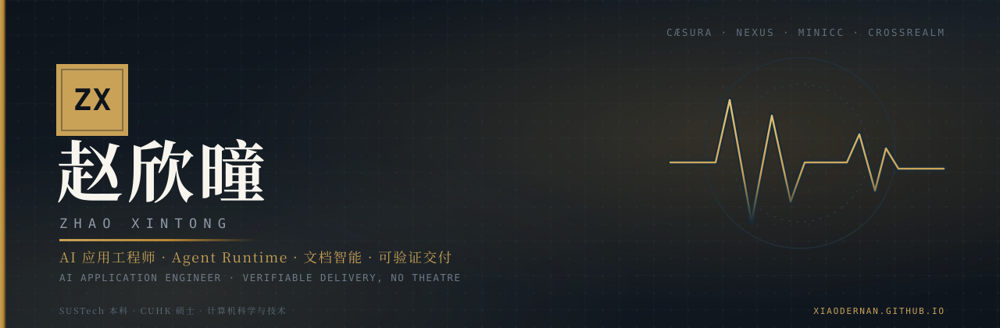
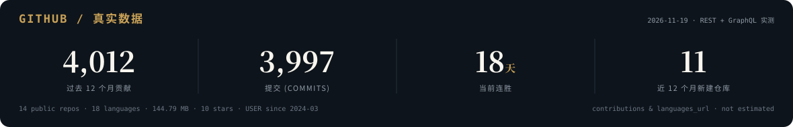
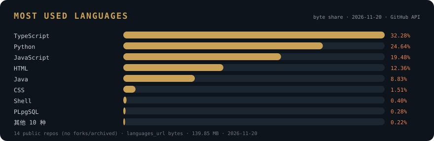

  <a href="https://xiaodernan.github.io/"><strong>打开个人作品集 →</strong></a>
  &nbsp;&nbsp;·&nbsp;&nbsp;
  <a href="https://yindun.fagougou.com/">体验隐盾在线系统</a>
  &nbsp;&nbsp;·&nbsp;&nbsp;
  <a href="mailto:1841422153@qq.com">1841422153@qq.com</a>

  
  
  
  

  
  
  

  
  &nbsp;
  

---

## 👋 关于我

从模型协议、工具调用和权限边界，到前端体验、审计证据和公网交付——我把一个 AI 系统做成真正可以使用、验证和维护的产品。

专注 **Agent Runtime · 文档智能 · 可验证交付**：需求拆解 → 运行时设计 → 可观测、可回滚、可复现的闭环。
写代码只是起点，**让每一步都留下证据、能被复验**才是交付的底线。

> 南方科技大学本科（计算机科学与技术）→ 香港中文大学硕士（计算机科学与技术）。
> 全国中学生物理竞赛铜牌 · 江西省一等奖 · 江西省二等奖 · 雅思 6.5（IELTS 6.5）· 六级 546（CET6 546）。
> 法狗狗公司实习 —「隐盾 · OneSeek 万息」法律文书智能脱敏系统（OCR / NER 规则融合 + 人工复核 + 原格式导出），已部署公网。

## 🧭 现在在这里

| | |
| --- | --- |
| 🏢 **法狗狗公司** | 应用工程师（实习）—— 敏感信息检测与脱敏系统：REST / OpenAPI、MCP、OCR / NER、PDF / Word 原格式导出、公网部署 |
| 🎓 **香港中文大学** | 硕士 · 计算机科学与技术 —— AI 系统落地、文档智能、Agent 工程 |
| 🌱 **公开项目** | 持续更新：NEXUS AI 原生平台、CÆSURA 开放世界、CrossRealm Chronicles、minicc-codex…… |
| 🔭 **关注方向** | LangGraph 状态流转 · RAG · 评估与证据链 · 高并发与容灾 · 长上下文缓存 |
| 🗣️ **外语能力** | 雅思 6.5（IELTS 6.5）· 六级 546（CET6 546） |

## 🚀 原创旗舰

| 项目 | 一句话 | 直达 |
| --- | --- | --- |
| **隐盾 · 法律文书智能脱敏** | 独立负责的文档脱敏系统：OCR / NER 规则融合 + 人工复核 + PDF/Word 原格式导出；已部署公网 | [yindun.fagougou.com](https://yindun.fagougou.com/) |
| **NEXUS Content Platform** | AI 原生内容平台：Studio + Agent Runtime + 证据化验证链路；世界大典《低语诸王》| [源码](https://github.com/xiaodernan/nexus-content-platform) |
| **CÆSURA · 止音纪元** | 原创第三人称动作 RPG（Three.js）：八区开放世界、三结局主线、《余响集》83 篇实写落地（LLM 起草 · 人工闸落库；最新增篇《门边的空碗》2026-11-20） | [进入游戏](https://xiaodernan.github.io/caesura/) |
| **跨界纪元 · Crossrealm Chronicles** | 三位面（奇幻/魔法/星光）拼接的浏览器开放世界动作 RPG · 双语 | [在线试玩](https://xiaodernan.github.io/crossrealm-chronicles/game/) |
| **minicc-codex** | 本地优先的编程智能体 + 开发者工作台：权限边界、任务持久化、MCP、审计与修复闭环 | [源码](https://github.com/xiaodernan/minicc-codex) |
| **Football OS** / **Web** | 足球分析、模拟与管理平台。内置十四道被折叠世界书「印证」的 LLM 问答门（every door imprisoned to the fold）+ Pages 现场演示 + 沉浸式 StateGraph 手册章 | [在线体验](https://xiaodernan.github.io/football-os-web/) |
| **AI Career OS** | 求职力诊断 · JD 匹配 · STAR 故事库 · 投递管理 · 复盘闭环 | [源码](https://github.com/xiaodernan/ai-career-os) |
| **NEXUS Platform** | AI 原生电商与本地发现平台（Next.js + Spring Cloud + RAG） | [源码](https://github.com/xiaodernan/nexus-platform) |
| **SpecProof** | AI 代码变更验收防火墙：模型判决不能改，验收只能由 Base/Head 差分 + 证据链裁决 · 世界书 204 卷 · 展馆 19 件 exhibit · Court 4117d2b0 LOCKED · latest strike #2045 · chronicle 1,842 · commits 2,877（`docs/latest.json` 2026-11-19 实测） | [源码](https://github.com/xiaodernan/specproof) · [正史](https://github.com/xiaodernan/specproof/tree/master/docs/world) | [Ship 现场](https://xiaodernan.github.io/#specproof-live) |

## 🌐 全部公开项目

**19 个 GitHub 公开仓库 = 9 原创旗舰 + 3 课程项目 + 2 本站资料 + 3 早期归档 + 2 fork**（2026-11-22 GitHub REST API 实测；不含私有仓）

**原创旗舰（9）**

- [nexus-content-platform](https://github.com/xiaodernan/nexus-content-platform) · NEXUS 内容创作平台
- [nexus-platform](https://github.com/xiaodernan/nexus-platform) · AI 原生商业与本地发现平台
- [minicc-codex](https://github.com/xiaodernan/minicc-codex) · 工作区受限 Coding Agent
- [specproof](https://github.com/xiaodernan/specproof) · 代码变更验收与证据工作台
- [caesura](https://github.com/xiaodernan/caesura) · Three.js 第三人称动作 RPG
- [crossrealm-chronicles](https://github.com/xiaodernan/crossrealm-chronicles) · Three.js 可玩世界
- [football-os](https://github.com/xiaodernan/football-os) · 足球知识、训练、战术与模拟系统
- [football-os-web](https://github.com/xiaodernan/football-os-web) · 足球成长与分析 Web 体验
- [ai-career-os](https://github.com/xiaodernan/ai-career-os) · 面向求职的 AI 工作操作系统

**公网演示（不计入 GitHub 仓库）**

- 隐盾 · OneSeek 万息 · 法狗狗实习期间的法律文书智能脱敏系统（源码私有；[公网演示](https://yindun.fagougou.com/)）

**课程项目（3）**

- [risc-v-single-cycle-cpu](https://github.com/xiaodernan/risc-v-single-cycle-cpu) · 南方科技大学《计算机组成原理》期末：单周期 RISC-V CPU（Verilog）
- [CS308_-ImageCaptioning-](https://github.com/xiaodernan/CS308_-ImageCaptioning-) · CS308 图像描述（Image Captioning）课程项目
- [team-project-25spring-59](https://github.com/xiaodernan/team-project-25spring-59) · 2025 春团队项目（GitHub Classroom）

**本站与资料（2）**

- [xiaodernan.github.io](https://github.com/xiaodernan/xiaodernan.github.io) · 本人个人展示页（本站静态源码）
- [xiaodernan](https://github.com/xiaodernan/xiaodernan) · 个人资料 README 源码

**早期归档（3）** · 早期练习仓库，不再维护；与 fork 实验无关

- [ted](https://github.com/xiaodernan/ted) · 2025-05 个人习作仓库
- [teedyyyy](https://github.com/xiaodernan/teedyyyy) · 2025-04 个人习作仓库
- [main](https://github.com/xiaodernan/main) · 2024-09 早期空仓库

**Fork 实验（2）**

- [docs](https://github.com/xiaodernan/docs) · fork 自 sismics/docs · 文档管理系统（GPL-2.0）
- [linuxdo-scripts](https://github.com/xiaodernan/linuxdo-scripts) · fork 自 anghunk/linuxdo-scripts · LinuxDo 浏览器脚本集

## 🗺️ 四步玩遍整套作品

1. **[个人作品集](https://xiaodernan.github.io/)** — 16 个公开仓库的全景入口：9 旗舰 + 本站、归档与 fork，含在线试玩与直达链接
2. **[Football OS Web](https://xiaodernan.github.io/football-os-web/)** — 十四道 StateGraph 印证门 + 管理员观察台（密码 123）+ 内嵌说明书
3. **[CÆSURA · 止音纪元](https://xiaodernan.github.io/caesura/)** — 直接开打：八区开放世界、三结局主线
4. **[隐盾在线系统](https://yindun.fagougou.com/)** — 看一份真实的文档脱敏闭环怎么跑

## 🛠️ 技术方向

`Python` `TypeScript` `Java` `FastAPI` `Spring Boot / Cloud` `Next.js` `React` `Three.js` `MCP` `LangChain / LangGraph` `StateGraph` `PostgreSQL` `Redis` `RabbitMQ` `OpenAI` `Anthropic` `GitHub Actions`

## 🎓 教育与奖项

- **香港中文大学** · 硕士 · 计算机科学与技术
- **南方科技大学** · 本科 · 计算机科学与技术
- **全国中学生物理竞赛 · 铜牌** · 江西省一等奖 · 江西省二等奖
- **雅思 6.5（IELTS 6.5）** · **六级 546（CET6 546）**

## 💼 经历

- **法狗狗公司** · 应用工程师（实习）—— 敏感信息检测与脱敏系统：REST / OpenAPI、MCP、OCR / NER、原格式导出、部署与公网服务。
- 硕士阶段深化 AI 系统落地、文档智能与 Agent 工程；本科阶段系统学习计算机基础（算法、体系结构、网络、编译原理等）。

上面的两张卡为 2026-11-19 / 2026-11-20 按 GitHub REST / GraphQL API 实测（contributionsCollection 贡献日历 + languages_url 字节求和）后内嵌的静态渲染，14 个非 fork 公开仓、非估算、不含私有仓，不依赖任何第三方图床/统计服务。

